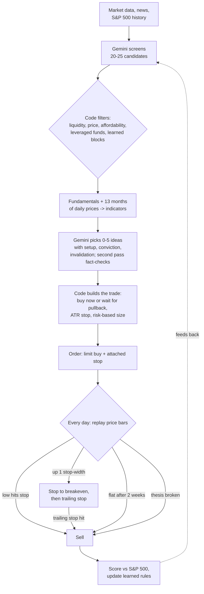

# TrendPilot

**An LLM-driven trading agent that screens the market, sizes positions by risk, rides trends with trailing stops, and scores every pick against the S&P 500 to learn which setups actually work.** It paper-trades automatically through Alpaca.

TrendPilot splits the job the way a disciplined trading desk would: a language model (Google Gemini, with web search) decides *what* is worth buying and whether a thesis still holds; deterministic code decides *when* to buy, *how much*, and *when to sell*, from real price data. Every recommendation is tracked like a real position and benchmarked against SPY over the exact same dates, and those results feed back into the next day's decisions.

> **Not financial advice.** TrendPilot is a research and paper-trading project. Its live auto-trading is hard-wired to Alpaca's paper (simulated) server. Do your own diligence before acting on anything it produces.

---

## Highlights

- **Two-brain design.** The LLM picks ideas and judges theses; code owns every price, stop and size, so the model can't invent numbers.
- **Ride-the-trend exits.** No profit targets: ATR-based initial stop → breakeven → trailing stop that only moves up. Losers are cut fast; winners are held as long as the trend lasts. Trades that go nowhere for two weeks are dropped.
- **Measured, not vibes.** Each pick is replayed bar-by-bar against daily prices and compared with the S&P 500 over the same holding period.
- **It learns.** After 10+ closed trades of a kind, losing setups are blocked or sized down, winning ones favored, and conviction-based sizing is dropped if conviction doesn't predict results.
- **Real broker integration.** Reads an Alpaca account to size in whole shares and check stop orders; optional paper auto-trading places entries with attached stops and switches to Alpaca's native trailing stops.
- **Built for free tiers.** A quota-aware, caching data client keeps a full daily run inside FMP's 250-call free plan, with a reserve so open positions are always priced.
- **Safe and private by construction.** Separate read-only and paper-only modules, no API keys in error output, and account data that never leaves your machine.
- **123 unit tests** covering the exit engine, sizing, learning rules, broker logic and failure handling.

---

## How a trade works



1. **Gather.** Movers, index levels, VIX, 10-year yield, sector performance and the 14-day earnings calendar ([Financial Modeling Prep](https://site.financialmodelingprep.com)); business, market and sector headlines ([NewsAPI](https://newsapi.org)); a year of SPY prices as the benchmark.
2. **Screen (LLM).** Gemini reads the day's data, the news and the agent's own track record, and proposes 20–25 candidates, each tagged with a *setup* (pullback in uptrend, breakout, oversold bounce, earnings catalyst, …).
3. **Filter (code).** Drops leveraged/inverse funds, sub-$250M companies, sub-$3 shares, anything one share of which would break the per-position cap, and setups the agent has learned to avoid.
4. **Measure (code).** For survivors: valuation, margins, debt and analyst targets, plus trend (20/50/200-day averages), RSI, average true range, 1/3/6/12-month momentum, distance from the 52-week high, volume and relative strength vs the S&P 500.
5. **Decide (LLM).** Gemini picks 0–5 ideas. Each needs both a fundamental or catalyst reason *and* supporting price action, plus a conviction score and an observable invalidation condition. A second pass audits the draft against the data.
6. **Build the trade (code).** Overextended stocks (RSI > 75, far above the 20-day average, or a one-day spike) get a limit buy at a pullback level instead of a market buy. Initial stop = 1.5–2.5 × ATR. Size = 0.75% of the account at risk ÷ stop distance, scaled by conviction, halved near earnings or in downtrends, capped per position and per category, in whole shares.
7. **Manage (code, daily).** Every bar since the last run is replayed: stop hits are recorded at the right price (gap-downs fill at the open), +1R moves the stop to breakeven and starts the trailing stop, and a trade still flat after two weeks is sold.
8. **Learn.** Closed trades are scored against SPY and grouped by setup, conviction and expected hold; the learned rules shape the next run.

### The rules

| | |
|---|---|
| **Entry** | Buy now, or a 14-day limit buy at a pullback if the stock is overextended |
| **Initial stop** | 1.5 / 2.0 / 2.5 × ATR for swing / short-term / long-trend ideas, bounded per category |
| **Breakeven** | When price reaches +1 stop-width, the stop moves to the entry price |
| **Trailing stop** | From +1R: 2.5–3.5 × ATR below the highest price (6–25%), only moves up |
| **Flat-trade exit** | Two weeks in and still below +½ stop-width → sold to free the cash |
| **Thesis broken** | The daily LLM review can close a position — only on concrete evidence, labelled as judgment |
| **Profit target** | None. Winners ride until the trailing stop is hit |
| **Sizing** | 0.75% account risk per trade ÷ stop distance; 10% max per position; category caps; 70% max invested |
| **Universe** | No leveraged/inverse ETFs, options or margin; ≥ $250M market cap; ≥ $3/share |

All numbers live in [`src/analysis/strategy.py`](src/analysis/strategy.py). Personal limits (position cap, category ranges, excluded vehicles) are read from your investor profile.

### How it learns

Every pick records *why* it was made. Once a setup has at least 10 closed trades:

- lost to the S&P 500 by > 3 points on average and beat it < 40% of the time → **blocked**;
- trailing the S&P at all → **sized 25% smaller**;
- beating it by 3+ points > 55% of the time → **favored** in the model's instructions.

If high-conviction picks stop outperforming low-conviction ones, sizing stops trusting conviction. Below 10 trades nothing is learned. A handful of lucky or unlucky picks shouldn't rewrite the rules.

---

## Architecture

```
src/
├── main.py                  orchestrates a run (fetch → manage → learn → analyze → trade → report)
├── config.py                settings from .env
├── fetchers/
│   ├── fmp_client.py        cached, quota-aware FMP client (budget, reserve, loud 429s, no key leaks)
│   ├── market_data.py       movers, macro, sectors, earnings, price history, universe rules
│   ├── fundamentals.py      valuation, margins, analyst targets
│   ├── news_fetcher.py      NewsAPI headlines
│   └── broker_alpaca.py     READ-ONLY Alpaca account, positions and orders (GET only)
├── analysis/
│   ├── analyzer.py          4-stage Gemini pipeline: screen → draft → verify → extract (JSON)
│   ├── technicals.py        indicators from daily bars
│   ├── strategy.py          every rule and limit; loads the investor profile
│   ├── positions.py         position book, trade plans, bar-by-bar exit engine
│   ├── performance.py       track record vs SPY and learned rules
│   └── account.py           whole-share sizing, allocation from real holdings, order checks
├── execution/
│   └── paper_trader.py      opt-in, PAPER-ONLY order placement
└── report/
    ├── advice.py            code-written Action Plan and Track Record
    ├── report_builder.py    Markdown + PDF report
    ├── dashboard.py         data for the local dashboard
    ├── obsidian.py          optional Obsidian vault sync
    └── emailer.py           optional email delivery
dashboard/                   static dashboard (Chart.js, Marked) + dashboard_server.py
tests/                       123 unit tests, no network needed
```

### Design decisions worth calling out

- **The model never sets a price.** Prompts forbid entries, stops and targets; a verification pass strips any that slip through; extraction uses JSON mode; ideas for tickers without verified data are dropped.
- **Exits are replayed, not polled.** Each run replays every daily bar since the last one, so a stop hit on Tuesday is recorded at Tuesday's price even if the next run is Thursday. Checking less often loses nothing.
- **Split-safe accounting.** Price history is split-adjusted but recorded entries aren't; the engine detects split-sized discrepancies and rescales every stored level instead of booking a fake 90% loss.
- **Quota is a first-class constraint.** Responses are cached per endpoint (quotes 15 min, history 12 h, fundamentals 7 days); symbols the free plan doesn't cover are remembered; non-critical work stops before eating the reserve kept for pricing positions; backfilling old picks runs last.
- **Failure isolation.** If the LLM is down, the run still manages every open position and writes the report. One failed order doesn't stop the rest.
- **Read-only vs. paper-only.** The account reader contains no code that can place orders, and a test enforces that. Order placement lives in a separate module that only knows the paper server's address and requires an explicit opt-in.
- **Alpaca's own trailing stops.** Once a trade is working, the fixed stop is swapped for a native `trailing_stop`, so protection keeps tracking the price even when the agent isn't running. Because Alpaca's trail starts from the price at placement, the switch only happens when that's at least as protective as the current stop.
- **Privacy.** Account balances and holdings are used locally for sizing and never sent to the model. The affordability filter tells the model only to include lower-priced names, never the dollar cap.

---

## Getting started

**Requirements:** Python 3.10+, free API keys for FMP, NewsAPI and Google Gemini; optionally an Alpaca account.

```bash
git clone https://github.com/<you>/trendpilot.git
cd trendpilot
python -m venv venv
venv\Scripts\activate            # Windows  (macOS/Linux: source venv/bin/activate)
pip install -r requirements.txt
cp .env.example .env             # then fill in your keys
cp -r profile.example profile    # then edit your limits
```

| Key | Used for | Free tier |
|---|---|---|
| `FMP_API_KEY` | prices, history, fundamentals, movers | 250 requests/day; covers a limited set of mostly large-cap symbols |
| `NEWSAPI_KEY` | headlines | 100 requests/day (developer tier) |
| `GEMINI_API_KEY` | analysis | free tier via Google AI Studio |
| `ANALYSIS_MODEL` | Gemini model name | defaults to `gemini-2.5-flash` |

Run it:

```bash
python -u -m src.main            # report (Markdown + PDF) and dashboard data
python -u -m src.main --email    # also email the PDF (SMTP settings in .env)
python dashboard_server.py       # dashboard at http://localhost:8765
```

### Investor profile

`profile/investor-one-pager.md` (git-ignored) sets your personal limits in YAML frontmatter: risk tolerance, max position size, category ranges and excluded vehicles. Start from [`profile.example/`](profile.example). [`investor-strategy-system-prompt.md`](investor-strategy-system-prompt.md) is an interview prompt that produces a filled-in profile with any capable LLM. Only the generic limits are ever sent to the model.

### Alpaca (optional)

```ini
ALPACA_API_KEY_ID=...
ALPACA_API_SECRET_KEY=...
ALPACA_ENV=paper          # paper | live — each has its own keys
ALPACA_AUTOTRADE=paper    # optional: let the agent trade the PAPER account itself
```

```bash
python -m src.fetchers.broker_alpaca    # connection check: balances, margin status, positions — never prints keys
```

With an account connected, TrendPilot sizes in **whole shares** (Alpaca only allows day orders on fractional shares, so they can't hold a standing stop), only considers stocks you can afford one share of, counts real holdings against allocation limits, and checks your stop orders every run (missing, partial, too low, should switch to trailing, still holding something the plan sold). It also warns if margin or short selling is enabled.

With `ALPACA_AUTOTRADE=paper`, each run also places the trades: one OTO order per entry (limit buy + stop), stop raises, the switch to a native trailing stop, exits, and cancellation of entries that never filled. Paper equity vs. the S&P 500 since auto-trading began is shown in every report. **There is no live auto-trading.**

### Scheduling

A daily run before the market opens is the intended cadence: decisions use daily bars, and stop orders at the broker protect positions in between. On Windows, Task Scheduler running `run_daily.bat` weekdays at 7:00 AM works well (enable *wake to run* and *run as soon as possible after a missed start*). Output is appended to `reports/run_log.txt`.

---

## Output

- **Action Plan:** today's buys (with size, initial stop and trailing rule), limit buys waiting for a pullback, sells and stop adjustments, account checks, and the orders the agent placed. Written by code, never by the model.
- **Track Record vs S&P 500:** every closed pick next to SPY over the same dates, by setup and by expected hold, with average days held.
- **Narrative:** market situation, structural themes, the new ideas with thesis, catalyst, key risk and invalidation, and a review of open positions.
- **Dashboard:** portfolio, news, Buy/Sell (actions, positions, track record, learned rules), market overview and the full report.

## Testing

```bash
python -m unittest discover -s tests -t .
```

No network access needed. Covers stops, gaps, breakeven, trailing and flat-trade exits; limit orders; sizing and allocation; stock splits; the learning rules; the FMP client's quota and caching behavior; the broker reader's read-only guarantee; paper-trader order payloads; and the analysis fallback.

## Limitations

- **No proven edge yet.** The rules follow well-documented effects (momentum, trend following, risk-based sizing), but whether this combination beats the S&P 500 is exactly what the paper-trading test measures.
- **Daily data.** Positions are re-evaluated once a day; intraday protection comes from stop orders at the broker.
- **Free-tier data.** FMP's free plan covers a limited symbol set, which narrows the universe, especially for small accounts.
- **Paper fills are generous.** Real fills would usually be somewhat worse.
- **No chart-pattern recognition.** Signals come from price-derived indicators, not drawn patterns, by design: the evidence for classic patterns is weak.

## Roadmap

- Systematic momentum score (6–12-month return, 52-week-high proximity, relative strength) to rank candidates
- Post-earnings-announcement drift signal
- Lightweight positions-only run (no LLM) for after the close
- Alpaca market data as a fallback for symbols outside FMP's free plan

---

*Built with Python, Google Gemini, Financial Modeling Prep, NewsAPI and Alpaca. Not affiliated with any of them.*
